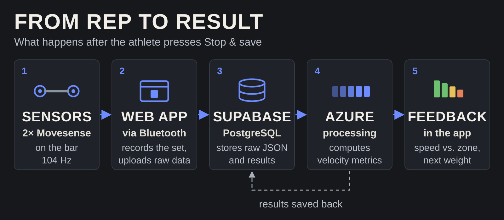

<p align="center"></p>

<p align="center"><b>Velocity-based training for powerlifting, with two sensors on the barbell.</b><br>
KTH Sports Technology HT26 · Arvid · Greipur · Hugo · Silje · Svanberg</p>

---

V-LO measures how fast the barbell moves on every rep, using two Movesense IMUs on the bar ends, and turns it into feedback for the next set. Instead of a fixed weight, the coach gives each lift a **target velocity zone**; the athlete records the set from the browser, and a few seconds after pressing Stop sees the mean and peak velocity of each rep, whether the set hit the zone, and a suggested load for the next set.

This repository holds the web platform, the database setup and the cloud processing. The velocity algorithm is developed by the data team in [Product-testing](https://github.com/SportsTechVeloProject/Product-testing) and copied in unchanged.

## How it works

<p align="center"></p>

1. **Sensors:** two Movesense sensors stream accelerometer and gyroscope data at 104 Hz over Bluetooth, straight into the browser (Web Bluetooth).
2. **Web app** (`vlo.html`, `js/`): records the set and uploads the raw data with the set's reps, load and target zone.
3. **Supabase** (PostgreSQL + storage): stores the raw JSON in `raw-sessions` and a row in `sessions`. A database webhook starts the processing; a scheduled job retries any recording that was missed.
4. **Azure Functions** (`python/function_app.py`): runs the data team's analysis (`python/squat/`, via `python/squats.py`) and saves the velocity of every rep back to the database.
5. **Feedback:** the app shows the result as soon as it is saved, with no refresh.

Details: [docs/azure-processing.md](docs/azure-processing.md) · [docs/database.md](docs/database.md) · [next steps](docs/next-steps.md)

## Running it locally

The website is plain HTML, CSS and JavaScript; any static file server works:

```
python -m http.server 8080
```

Then open `http://localhost:8080/vlo.html` in **Chrome or Edge** (Web Bluetooth). Log in with your V-LO account. Adding `?mirror=1` lets a single sensor stand in for both, for testing only.

The analysis can also be run on a laptop for debugging, e.g. `python main.py --session <id>` from the `python/` folder; see the top of [python/main.py](python/main.py). It needs numpy, scipy, pandas, matplotlib and imufusion (`python/requirements.txt`).

## Repository

| Path | What |
|---|---|
| `vlo.html`, `js/`, `css/` | The web platform: training, plans, teams, recording |
| `python/` | Cloud processing (Azure Functions) and the local debugging tool `main.py` |
| `python/squat/` | The data team's squat analysis, copied unchanged by `python/sync_data_team.py` |
| `supabase/` | Database schema, migrations and read-only queries |
| `docs/` | Architecture, database and processing documentation |

## Future work

- [ ] **Better drift handling** to make fast, light lifts as accurate as heavy ones
- [ ] **Bench press and deadlift** analysis, validated like the squat
- [ ] **A larger validation study** with powerlifters
- [ ] **Combine both sensors**, e.g. to measure left–right balance
- [ ] **Automatic rep detection**, so no rep count has to be entered
- [ ] **Estimate the 1RM** from the athlete's load–velocity profile
